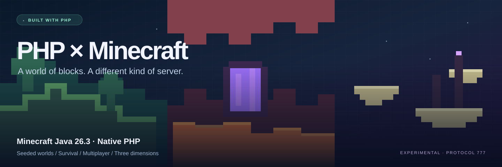

# PHP Minecraft Java Server

[](https://github.com/lunaboppin/php-minecraft-java-server/actions/workflows/test.yml)


**A world of blocks. A different kind of server.**

A native PHP server for **Minecraft Java 26.3, protocol 777**, with three dimensions, seeded terrain, survival progression, crafting, containers, multiplayer, and persistent worlds. Java is used only by the optional reference-data tooling; the running game server is PHP.

**Public server: `65.109.29.143:25676`** — join with **Minecraft Java Edition 26.3** using Multiplayer → Add Server.

This remains an experimental implementation, **not full vanilla parity**. Its terrain is generated by an original deterministic PHP algorithm. A given seed reproduces this server's world, but does **not** reproduce Mojang's terrain for that seed. Native Java-compatible random and scalar noise primitives are checked against the pinned official JAR; see [terrain implementation evidence](tools/WORLDGEN.md) for coverage and remaining work.

| Explore | Build and survive | Run and inspect |
| --- | --- | --- |
| Overworld hills, oceans and caves | Crafting, mining and tool wear | Native PHP; no Java runtime dependency |
| Nether lava caverns and fungal forests | Chests, furnaces and saved inventories | SQLite worlds and player persistence |
| End islands, pillars and return fountain | Food, combat, animals and respawns | Independent TCP tests and official packet decoding |

## Start

Requires **64-bit PHP 8.5.12+ CLI**, with JSON, zlib, iconv, PDO, and PDO SQLite. Online mode additionally requires OpenSSL and cURL with asynchronous DNS. Python and Java are not required to run the packaged server. Do not run it through PHP-FPM, Apache, or PHP's HTTP development server.

```sh
php bin/server.php --config=server.json
```

The downloadable package includes `server.json`, configured to listen on all IPv4 interfaces at **TCP port 25676**. Connect using Minecraft Java **26.3** to `your-server-IP:25676`, or `localhost:25676` on the same machine. The package also includes `start.sh` and `start.bat` launchers.

For a fresh source checkout:

```sh
git clone https://github.com/lunaboppin/php-minecraft-java-server.git
cd php-minecraft-java-server
cp server.example.json server.json
# Set host, port, operators and world settings in server.json.
php bin/server.php --config=server.json
```

The example binds to loopback. Set `host` to `0.0.0.0` for other machines to connect. Firewall/router configuration is external to this application. Without `--config`, the CLI uses its built-in defaults (loopback, port 25565, terrain seed 12345).

Use the latest stable PHP security release. The minimum is **PHP 8.5.12**, verified against PHP's [official release feed](https://www.php.net/releases/index.php?json&version=8.5) on 25 October 2026; the server refuses older runtimes. Check `php -v` after updating and restart the server so the running process uses the patched executable. PHP is installed separately and is not bundled in the ZIP. GitHub Actions installs the latest stable PHP release with updates enabled and runs the full suite.

Stop with Ctrl+C or SIGTERM. Player data is saved on disconnect and shutdown, with periodic saves while playing. Block and container changes are written to SQLite as they happen.

## Pelican / Pterodactyl

Import the [server egg](https://raw.githubusercontent.com/lunaboppin/php-minecraft-java-server/main/deploy/panel/egg-php-minecraft-java-server.json) to install directly from this GitHub repository. It builds the latest stable PHP 8.5 patch from checksum-verified official source, uses the primary panel allocation, and saves cleanly on Stop. Reinstall updates application files/PHP while preserving `server.json` and `data/`.

The initial PHP build takes several minutes. Use the supplied Debian yolk and allocate at least 1 GiB RAM and 2 GiB disk. See the [panel setup guide](deploy/panel/README.md) for import steps, settings, updates and backups.

## World generation

Set `generator` to `terrain` and choose an integer `seed` in the signed 32-bit range. Generation includes:

- Smooth continents, hills and mountains, coastlines, oceans, river channels, and beaches.
- Plains, forest, taiga, snowy plains, desert, meadow, ocean, river, and beach biome assignments.
- Grass/dirt, sand, stone, deepslate and a bedrock floor at Y=-64.
- Broad caves, intersecting twisting tunnels, small underground water pockets, deep lava, and clustered coal, iron, copper, gold, redstone, lapis and diamond ores.
- Oak, birch and spruce trees, leaves, grass, flowers, snow and frozen surface water in cold areas.
- Desert cacti and dead bushes, sandstone beneath sand, gravel patches, shoreline sugar cane, forest mushrooms and high-altitude snow.
- A small dry clearing around the initial spawn, including seeds that would otherwise start in water.
- All 24 chunk sections, mixed biome palettes, two heightmaps, direct skylight, and block-light propagation within each chunk. Caves are dark and emissive blocks illuminate nearby air.

The generator name, seed, and algorithm version are saved in the database. **Use a new `worldPath` to change the seed or generator**; changing them underneath an existing saved world is rejected. Chunk generation order and negative chunk coordinates do not change the generated result.

When opening an older `terrain-v1` save, the server preserves that algorithm for previously recorded explored/edited chunks. Newly generated chunks use `terrain-v2`, which keeps the same surface heights while improving underground tunnels and surface decoration. New saves use v2 throughout. Back up all world databases before upgrading; this is a forward migration.

The original flat-world database remains separate at `data/world.sqlite`. To open it with the newer server, use:

```sh
php bin/server.php --config=server-flat.example.json
```

That example listens locally on port 25565. The terrain world uses `data/world-terrain.sqlite`. Worlds use this application's SQLite schema, not vanilla Anvil region files.

## Dimensions and portals

Every server has three separately saved worlds:

| Dimension | Terrain and atmosphere | Saved file |
| --- | --- | --- |
| Overworld | Continents, rivers, trees, caves, ores; Y=-64…319 | Configured `worldPath` |
| Nether | Lava seas, bedrock floor/roof, five biomes, quartz/gold ores, ancient debris, giant fungi, roots and glowstone; Y=0…255 | `<worldPath>.the_nether.sqlite` |
| End | Central island, surrounding void, outer islands, chorus plants, obsidian pillars, arrival platform and exit fountain; Y=0…255 | `<worldPath>.the_end.sqlite` |

Use **`/dimension overworld|the_nether|the_end`** as an operator. `/tp player` follows that player's dimension. Travel retains your inventory, health and mode; reconnecting restores your saved dimension. Death returns you to your Overworld respawn point. Blocks, containers, dropped items, animals, lighting and nearby player entities are scoped to their dimension.

Build an obsidian frame with an interior from 2×3 to 21×21 blocks and use flint and steel on its bottom interior to activate a Nether portal. Survival players wait four seconds inside; creative players travel immediately after cooldown. Nether travel scales X/Z by 8:1, reuses registered nearby portals, and constructs an arrival frame when needed. Breaking a portal block or its adjacent frame collapses the connected interior. A cooldown prevents immediate return loops; leave the arrival portal before entering again.

An inward-facing ring of twelve End portal frames activates when its final Eye of Ender is inserted. Frames currently require creative items or commands because strongholds are not generated. The End's central exit fountain returns you to the Overworld. Water buckets cannot place water in the Nether; beds only set spawn in the Overworld. Bed explosions, respawn anchors, portal travel for mobs, end gateways, dragon/crystal encounters and credits are not implemented. Portal search uses this server's saved portal list, rather than vanilla's full portal-search algorithm.

## Gameplay

- Survival, creative, adventure and spectator modes, including appropriate flight/editing restrictions and game-mode updates.
- Saved player positions, rotations, selected hotbar slots, inventories, tool wear, game modes, health, hunger, saturation, experience and respawn points.
- Timed survival mining, basic tool material/tier checks, common block and ore drops, dropped item entities, pickup, hotbar/offhand swapping, and tool durability.
- Broader creative inventory access to plain vanilla items, and basic block placement properties for logs, stairs, slabs, facing blocks, doors and beds. Door/trapdoor/gate interactions toggle open states; beds set personal respawn points.
- Server-owned inventory state with left/right clicking, shift transfer, number-key swaps, cloning in creative, dropping, collecting matching items, and drag distribution. Client-predicted item hashes never create authoritative stacks.
- Ordinary vanilla 2×2 and 3×3 shaped/shapeless crafting recipes, including item-tag ingredients and mirrored patterns. Special crafting types, custom component results and the recipe book are not implemented.
- Shared, saved single-chest/barrel storage and crafting-table interfaces. Containers close when removed or out of reach.
- Saved furnace input/fuel/output, ordinary vanilla smelting recipes, fuel consumption, progress indicators and lit states. Furnaces run while activated near a connected player; offline/unloaded simulation is not implemented.
- Hunger/exhaustion, food consumption and saturation, natural regeneration, fall/void/fire/lava/drowning/starvation damage, health and oxygen updates, experience progress, death, item drops and respawn.
- Basic player combat and configurable PvP. Ordinary attacks against mobs use exported weapon damage/speed, charge scaling, base armor/toughness, shared hurt cooldowns, current damage events and weapon wear; see [mob melee coverage](docs/MOB-COMBAT.md). Player armor mitigation, enchantments, potion effects, projectiles, knockback and full combat/species behavior remain incomplete.
- Primary mob hurt/death voices use official sound data, with saved and synchronized cow, pig, chicken, cat and wolf voice variants, nearby listener delivery and float32 pitch calculations. See [mob sound coverage](docs/MOB-SOUNDS.md) for tested cases and remaining ambient, state-dependent and boss work.
- Multiplayer held-item, offhand and armor visibility, including hotbar selection, hand swaps, empty slots, damaged items, late joins and dimension re-entry. Player, supported mob and item visibility follows sent chunks and horizontal tracking range; spectators are hidden from ordinary players. Crouching/sprinting metadata and standing/crouching/death poses synchronize. Spectator camera targets, riding and complete pose/collision behavior remain incomplete.
- All 88 plain vanilla spawn eggs map to their official entity types, with block/face placement, source-fluid use, creative/survival consumption, synchronized base health/attributes and saved mob state. `/summon` accepts the registered mob types. [Mob coverage](docs/mob-coverage.md) separates tested creation from incomplete species behavior.
- Shared ground, swimming and flying movement uses exported block collision shapes, including local cave floors and roofs. Cows, pigs, sheep and chickens retain basic combat, loot and natural placement. Full species AI, hostile/ranged combat, spawn variants, breeding/taming and boss fights remain incomplete.
- Saved world time, daylight-cycle control, visual weather, basic gamerules, multiplayer chat, private messages, player visibility and movement.

## Commands and operators

Everyone can use `/help`, `/spawn`, `/list`, `/version`, `/msg`, `/tell` and `/me`.

Set `operators` in `server.json` to the usernames that should have administrative commands. Name matching is case-insensitive. Operator commands include:

```text
/dimension overworld|the_nether|the_end
/gamemode survival|creative|adventure|spectator [player]
/give player item [count]
/tp player
/tp [player] x y z
/time set day|noon|night|midnight|ticks
/time add ticks
/time query
/weather clear|rain|thunder
/seed
/setworldspawn [x y z]
/spawnpoint [x y z]
/setblock x y z block[property=value]
/fill x1 y1 z1 x2 y2 z2 block
/gamerule doDaylightCycle|keepInventory|naturalRegeneration [true|false]
/kill [player]
/heal [player]
/summon cow|pig|sheep|chicken [x y z]
/save-all
```

Coordinates accept `~` relative values. Fill operations are limited to 32,768 blocks. Commands and results are synchronized with the client command tree. The server does not implement vanilla command selectors beyond `@s` where a player argument is accepted.

Command handlers are organized as [individual PHP modules](docs/COMMANDS.md) under `src/Server/Commands/`, with shared registration, aliases, permissions and argument helpers. Use `python3 tools/php_style.py --check` to check their formatting; complete native command behavior remains tracked in issue #10.

The [mob movement reference](docs/MOB-MOVEMENT.md) documents exact official motion codecs, knockback arithmetic and tick-by-tick world trajectories, with the remaining live integration tracked in #86/#87. See [entity movement tracking](docs/ENTITY-TRACKING.md) for native relative/stepped packet delivery and late-viewer verification.

Set `onlineMode` to `true` for Mojang session verification and encrypted transport. New example, Docker and panel configurations enable it. Older configurations that omit the setting retain offline behavior; add `"onlineMode": true` explicitly to enable verification. In offline mode, names and operator names remain unverified.

Online players use separate `online:<UUID>` save records. Existing offline records and builds are preserved, and switching modes does not copy inventories between identities. Back up your saves before changing modes; an account's first online login starts a separate player profile. Operator name matching happens after successful verification in online mode. Session-service outages reject new online logins and do not fall back to offline access. See [authentication coverage](docs/authentication.md) for the current evidence and remaining parity checks.

The [protocol coverage inventory](docs/protocol-coverage.md) lists every official packet ID and the current source coverage. The [vanilla comparison harness](tools/parity/README.md) runs identical client scripts against isolated PHP and checksum-pinned Java servers, retaining first-divergence reports and bidirectional traces. Its scenarios cover selected gameplay and restart observations; they do not establish full parity.

Follow the [PHP structure and readability conventions](docs/CODING-STANDARDS.md) when changing code, including one command per file and the shared PHP formatting configuration.

## Roadmap

The target is **1:1 parity with the official Minecraft Java 26.3 server**. The [roadmap](ROADMAP.md) indexes 55 implementation/cleanup issues across four milestones, including the required project-identity cleanup. Each issue has acceptance criteria, validation expectations and prerequisites. The [tracking issue](https://github.com/lunaboppin/php-minecraft-java-server/issues/1) follows progress; current functionality remains experimental.

## Remaining differences from vanilla

There are no villages/strongholds/fortresses/End cities, vanilla noise-router terrain, full aquifer simulation, full biome population, complete hostile AI/combat, complete redstone machinery, automated farms, complete fluid shape/mixing rules, falling-block physics, crop/sapling growth, leaf decay, entity breeding, enchanting, brewing, trading, advancements, full loot tables, or multiplayer sleep simulation. Block-specific placement and neighbor updates are partial; fences, rails and other connected/stateful blocks do not have their full vanilla behavior.

Lighting is computed per chunk with direct vertical skylight; horizontal skylight propagation and light crossing a chunk edge are incomplete. Weather does not drive world simulation. Animal movement is simple and local; dropped items are temporary and not saved across restarts. Mob and item counts are bounded. Damage, enchantments, stored enchantments, enchantability and component removals are preserved by the [equipment stack bridge](docs/MOB-SPAWNING.md#equipment-stack-bridge) across supported packets and player saves. General custom component patches are rejected in creative inventory. Special menus and special recipe types are unsupported. Items and animals do not implement every vanilla effect or interaction.

This server has automated wire/progression checks, but the full graphical client feature set has not been interactively verified. It is not a production-ready public replacement for Mojang/Paper.

Water has scheduled downward/sideways flow, decay, draining and two-source regeneration. The initial redstone implementation supports lever/button power, flat dust lines, lamps, basic repeaters/comparators and powered doors/note blocks. Exact update order, pistons, observers, torch burnout, full support/connection shapes, quasi-connectivity, waterlogging and fluid mixing remain incomplete. Scheduled updates are saved per dimension and processed with a per-tick work budget.

Jukeboxes accept vanilla music discs, play and stop songs, eject discs and retain inserted discs through restart. Note blocks tune through 25 notes and select instruments from supporting blocks. Signs support front/back editing and persistent text; full wax/dye/glow and command components are still pending. Normal middle-click block selection works in creative and survival; Ctrl-pick component copying remains incomplete.

Chat, server replies, joins and leaves are appended to UTC daily `logs/server-YYYY-MM-DD.log` files. Retention defaults to **90 days** and can be set from 1 to 90 using `logRetentionDays`; `logDirectory` changes the directory. Logs remain uncompressed plain text: daily rotation and retention never convert them to `.gz`. Only the logger's own expired dated files are removed. Private-message text is included in these server-owner logs.

Client settings are parsed during configuration and play. The server applies requested render distance within its configured limit, synchronizes skin layers/main-hand preference, and anonymizes players who disable server-list listing. Locale, chat and particle preferences are recorded; full chat filtering/moderation behavior remains incomplete.

## Docker

```sh
mkdir -p data
PUID=$(id -u) PGID=$(id -g) docker compose up -d --build
docker compose logs -f
```

For occasional development chat updates, write a short public overview to `server-announcement.txt` beside the primary world database. The running server broadcasts and logs it once when players are present. Repeated identical messages are suppressed and new updates are limited to one every five minutes; the latest pending message waits through the cooldown. Only human-written public summaries belong here—do not copy logs, account details or infrastructure information into chat.

Before a deployment restart, write the full player-facing reason to `restart-reason.txt` beside the primary world database (normally `data/restart-reason.txt`). The running process reads it during shutdown, sends it in the disconnect packet, and consumes it once. For example: `Server restarting: mob damage fixes added. Please reconnect shortly.` UTF-8 messages up to 1024 bytes are accepted; missing or malformed files use the generic restart message. This works with Docker Stop/SIGTERM without a preliminary configuration reload.

The hosted main server follows the [deployment policy](docs/OPERATIONS.md): update and restart after each PR merged into `main`, with a restart kick reason and verified backups.

Connect on TCP **25676**. The container runs as your configured non-root UID/GID, uses PHP **8.5.12** with graceful signal handling, and checks health through the Minecraft status protocol. `data/server.json` is created only when absent. Worlds, configuration and 90-day logs live in the bind-mounted `data/` directory. Set `MINECRAFT_OPERATORS` and, if needed, `MINECRAFT_ONLINE_MODE=true|false` before the first start, or edit `data/server.json` and restart. Existing configuration is preserved. `SERVER_PORT` changes the published host port; the container listens on 25676.

To migrate an existing checkout, stop its PHP process cleanly, back up `data/`, then copy your existing `server.json` to `data/server.json`. Keep its world path under `data/` and set `logDirectory` to `data/logs`. Start Compose after the previous listener releases the port. Never run two processes against the same SQLite worlds. `docker compose stop` saves and sends connected players the restart reason before closing sockets. The image build excludes private configuration, saves, logs, Java caches and ZIP files.

## Validation and reference data

```sh
php tests/run.php --unit  # PHP primitives, official bytes, terrain, recipes and storage
php tests/run.php         # Also independent TCP multiplayer/progression suites; Python 3 required
composer test            # Equivalent when Composer is installed
python3 tests/parity/harness.py  # Differential comparison mechanics
```

The suites exercise TCP fragmentation/compression, login and 26.3 teleport confirmations, multiplayer, malformed input, chunk movement, keep-alives, terrain determinism, biome/height variation, ore/cave generation, inventory conservation, 2×2/3×3 crafting, shared chests, furnace smelting, survival mining, durability, food, combat, animal loot, death/respawn, commands and restart persistence. The full suite also checks dimension travel, separation of world edits/player visibility, Nether frame ignition and collapse, End portal activation, death across dimensions, and dimension persistence after restart. Allow a few minutes while chunks generate.

Reference rebuilding and independent packet decoding require Python **3.11+** and a **Java 25+ JDK**:

```sh
PHP_MINECRAFT_CAPTURE=/tmp/php-minecraft-capture.json php tests/run.php
JAVA_HOME=/path/to/jdk-25 python3 tools/update_reference.py --capture=/tmp/php-minecraft-capture.json
```

The tool verifies Mojang's metadata and JAR checksums, runs the official data generator, exports network registries and gameplay constants, resolves vanilla tags/recipe ingredients, and decodes captured PHP packets with official codecs. It also reconstructs client registries and reads every captured chunk's section, biome, heightmap and lighting data. Downloaded Java tooling stays under ignored `tools/.cache/`; the tool does not start a vanilla game server or change an EULA file.

```sh
python3 tools/package.py  # Build a ZIP with source, reference data and local SQLite backups
```

The public repository excludes runtime configuration, player records, world databases, logs and downloaded Java tooling. `tools/package.py` includes local saves by default when building a personal backup; keep those archives private if they contain player/world data. The archive includes Docker/Compose files and copies the active `data/server.json` configuration for both native and Docker startup, falling back to root `server.json` and then `server.example.json` on a fresh checkout. Logs and Java caches are excluded.

The reference source is Mojang's [official 26.3 metadata](https://piston-meta.mojang.com/v1/packages/61fff1316bd50312624a858bbb5eb18fa45208ed/26.3.json). Protocol is `777`, data version is `5023`, and the official server JAR SHA-1 is `33680f5f2ac32864d6d7cf5e56a705fdb3e05f4c`. The originally requested [historical wiki revision](https://minecraft.wiki/w/Protocol?oldid=2772350) was inaccessible and was not copied. See `NOTICE.md` for ownership and provenance.
